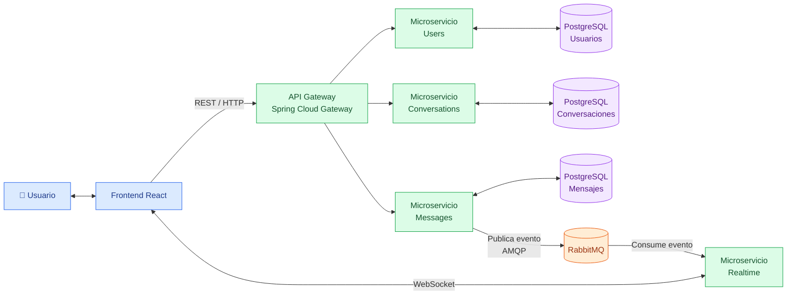

# 💬 SyncChat

<div align="center">

### Sistema de mensajería instantánea basado en microservicios

Una propuesta de arquitectura distribuida para la comunicación en tiempo real mediante WebSockets, API REST y RabbitMQ.


<br/>


</div>

---

## 📌 Introducción

**SyncChat** es un proyecto orientado al diseño e implementación de un sistema de mensajería instantánea que permita a los usuarios intercambiar mensajes en tiempo real, consultar sus conversaciones y mantener un historial de mensajes persistente.

La propuesta se basa en una **arquitectura de microservicios**, en la que cada componente tendrá una responsabilidad específica y podrá comunicarse con los demás mediante mecanismos de comunicación síncrona y asíncrona. Este enfoque busca favorecer la modularidad, el mantenimiento y la posibilidad de ampliar el sistema conforme evolucionen sus necesidades.

Para la comunicación instantánea se utilizarán **WebSockets**, que permiten mantener una conexión bidireccional entre el cliente y el servidor. Por su parte, **RabbitMQ** permitirá distribuir eventos entre los servicios sin exigir que todos los componentes procesen cada operación de manera simultánea.

El sistema contará con un frontend desarrollado con React, un API Gateway como punto de entrada para las solicitudes REST, microservicios implementados con Java y Spring Boot, y bases de datos PostgreSQL separadas por responsabilidad. Docker y Docker Compose permitirán organizar los componentes en contenedores y facilitar su ejecución conjunta.

Actualmente, el proyecto se encuentra en la etapa de definición de su arquitectura y selección de tecnologías. El objetivo es establecer una estructura clara antes de comenzar la implementación de los servicios.

## 🎯 Objetivos del proyecto

### Objetivo general

Desarrollar un sistema de chat en tiempo real basado en una arquitectura de microservicios que permita el intercambio instantáneo de mensajes entre usuarios y la gestión del historial de conversaciones.

### Objetivos específicos

- Implementar la comunicación en tiempo real mediante WebSockets y la mensajería asíncrona con RabbitMQ para el envío, la distribución y la recepción de mensajes.
- Diseñar e integrar los microservicios mediante API REST, bases de datos independientes y contenedores Docker, facilitando la persistencia del historial de conversaciones y el funcionamiento integrado de la aplicación.

## 🏗️ Arquitectura propuesta

La arquitectura estará organizada en componentes independientes que colaborarán para gestionar usuarios, conversaciones y mensajes.



> El diagrama representa el diseño previsto del sistema. Las conexiones y funcionalidades se validarán durante la implementación.

### Componentes principales

| Componente | Responsabilidad |
|---|---|
| **Frontend** | Interfaz para acceder a la aplicación, consultar conversaciones y enviar y recibir mensajes. |
| **API Gateway** | Centralizar el punto de entrada de las solicitudes REST y dirigirlas al microservicio correspondiente. |
| **Users** | Gestionar el registro, la autenticación y la información de los usuarios. |
| **Conversations** | Administrar las conversaciones y sus participantes. |
| **Messages** | Registrar mensajes, consultar el historial y publicar eventos cuando se crea un mensaje. |
| **Realtime** | Consumir eventos de mensajes y distribuirlos a los destinatarios conectados mediante WebSockets. |
| **RabbitMQ** | Recibir, enrutar y poner a disposición de los consumidores los eventos publicados por los servicios. |
| **PostgreSQL** | Almacenar de forma persistente los datos correspondientes a cada microservicio. |
| **Docker Compose** | Coordinar la ejecución de los contenedores y sus dependencias. |

## 🔄 Comunicación entre los componentes

SyncChat utilizará tres mecanismos principales de comunicación:

### 1. Comunicación síncrona: API REST

El frontend enviará solicitudes HTTP al API Gateway para operaciones como el registro de usuarios, la consulta de conversaciones y la recuperación del historial de mensajes.

El Gateway dirigirá cada solicitud al microservicio responsable de atenderla.

### 2. Comunicación asíncrona: RabbitMQ y AMQP

Cuando el microservicio Messages registre un nuevo mensaje, publicará un evento en RabbitMQ. El microservicio Realtime consumirá ese evento y se encargará de distribuirlo a los usuarios conectados.

De esta manera, el servicio que registra el mensaje no necesita esperar a que todos los destinatarios reciban la notificación para completar el procesamiento de la operación.

### 3. Comunicación en tiempo real: WebSockets

El frontend mantendrá una conexión WebSocket con el microservicio Realtime para recibir mensajes sin tener que realizar consultas HTTP repetitivas.

La conexión será bidireccional, lo que permitirá intercambiar información entre el cliente y el servicio mientras permanezca establecida.

## ✉️ Flujo de envío de un mensaje

El flujo principal previsto para enviar y recibir un mensaje será el siguiente:

1. El usuario escribe y envía un mensaje desde el frontend.
2. El frontend realiza una solicitud al API Gateway.
3. El Gateway dirige la solicitud al microservicio Messages.
4. Messages registra el mensaje en su base de datos PostgreSQL.
5. Messages publica un evento en RabbitMQ utilizando AMQP.
6. RabbitMQ pone el evento a disposición del microservicio Realtime.
7. Realtime procesa el evento y distribuye el mensaje mediante WebSocket a los destinatarios conectados.
8. El frontend recibe el mensaje y actualiza la conversación.

```text
Usuario
   │
   ▼
Frontend React
   │ REST / HTTP
   ▼
API Gateway
   │
   ▼
Microservicio Messages
   │
   ├──► PostgreSQL: guardar mensaje
   │
   └──► RabbitMQ: publicar evento
                    │
                    ▼
             Microservicio Realtime
                    │
                    ▼
             WebSocket
                    │
                    ▼
             Cliente destinatario
```

## 🧰 Tecnologías seleccionadas

| Categoría | Tecnología | Propósito |
|---|---|---|
| Lenguaje | Java 21 | Desarrollo del backend. |
| Framework backend | Spring Boot | Implementación de los microservicios. |
| API Gateway | Spring Cloud Gateway | Enrutamiento de solicitudes hacia los servicios. |
| Frontend | React | Construcción de la interfaz de usuario. |
| Comunicación síncrona | API REST sobre HTTP/HTTPS | Intercambio de solicitudes y respuestas. |
| Comunicación en tiempo real | WebSockets sobre TCP | Entrega de mensajes a clientes conectados. |
| Mensajería asíncrona | RabbitMQ con AMQP | Distribución de eventos entre microservicios. |
| Persistencia | PostgreSQL | Almacenamiento de usuarios, conversaciones y mensajes. |
| Contenedores | Docker | Empaquetado y ejecución aislada de componentes. |
| Orquestación local | Docker Compose | Inicio coordinado de los servicios y sus dependencias. |
| Control de versiones | Git y GitHub | Seguimiento de cambios y colaboración. |

## 🗄️ Estrategia de persistencia

El diseño propone separar los datos según la responsabilidad de cada microservicio:

- **Base de datos de Users:** información de los usuarios.
- **Base de datos de Conversations:** conversaciones y participantes.
- **Base de datos de Messages:** contenido de los mensajes y datos necesarios para consultar su historial.

Cada microservicio será responsable de gestionar sus propios datos. Esta separación busca reducir el acoplamiento entre servicios y permitir que cada uno evolucione de manera independiente.

El API Gateway y el servicio Realtime no necesitan una base de datos propia en la primera versión propuesta, ya que sus responsabilidades principales serán el enrutamiento y la distribución de eventos.

## 🐳 Ejecución y contenedorización

El proyecto se organizará para que cada microservicio tenga su propio directorio, código y `Dockerfile`. La configuración de Docker Compose coordinará los contenedores de la aplicación, RabbitMQ y las bases de datos necesarias.

Como objetivo de configuración, se busca poder iniciar el entorno completo mediante un único comando:

```bash
docker compose up --build
```

Este comando será utilizable cuando estén preparados los Dockerfiles, la configuración de los servicios, las variables de entorno y el archivo `compose.yaml` o `docker-compose.yml`.

## 📋 Alcance de la primera versión

La primera versión se centrará en establecer una base funcional para la mensajería instantánea.

- [ ] Diseñar y validar el diagrama de arquitectura.
- [ ] Crear la estructura independiente de los microservicios.
- [ ] Implementar el registro y la gestión de usuarios.
- [ ] Implementar la creación y consulta de conversaciones.
- [ ] Implementar el envío y la persistencia de mensajes.
- [ ] Configurar RabbitMQ y la publicación y el consumo de eventos.
- [ ] Integrar WebSockets para la entrega de mensajes en tiempo real.
- [ ] Construir el frontend con React.
- [ ] Configurar Docker y Docker Compose.
- [ ] Verificar el flujo completo desde el frontend hasta la recepción del mensaje.

Las casillas representan tareas previstas, no funcionalidades que ya estén terminadas.

## 🚀 Estado actual

**SyncChat se encuentra en fase de diseño de arquitectura.**

Hasta el momento, se ha definido una propuesta inicial de los componentes principales, sus responsabilidades, los mecanismos de comunicación y la separación de la persistencia.

Los siguientes pasos consisten en consolidar el diagrama, organizar la estructura del repositorio y comenzar la implementación progresiva de los microservicios.

## 📚 Conceptos clave

| Concepto | Significado en SyncChat |
|---|---|
| Microservicios | Componentes independientes con responsabilidades específicas. |
| API Gateway | Punto de entrada que dirige las solicitudes a los servicios. |
| WebSocket | Protocolo para mantener una comunicación bidireccional en tiempo real. |
| RabbitMQ | Intermediario que distribuye mensajes y eventos entre componentes. |
| AMQP | Protocolo de mensajería utilizado para comunicarse con RabbitMQ. |
| Persistencia | Almacenamiento de información para su consulta posterior. |
| Docker | Herramienta para empaquetar y ejecutar componentes en contenedores. |

---

<div align="center">

### 💬 SyncChat

**Comunicación en tiempo real mediante una arquitectura distribuida.**

Proyecto académico de diseño e implementación de sistemas distribuidos.

</div>
